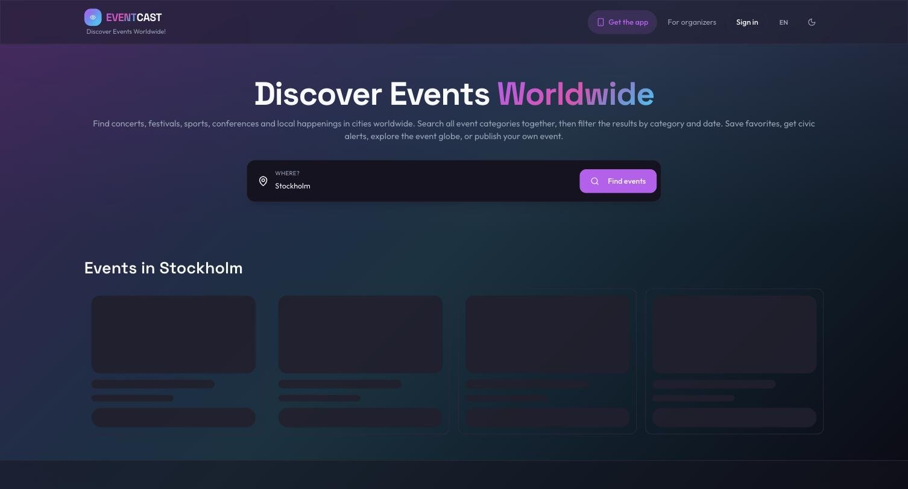
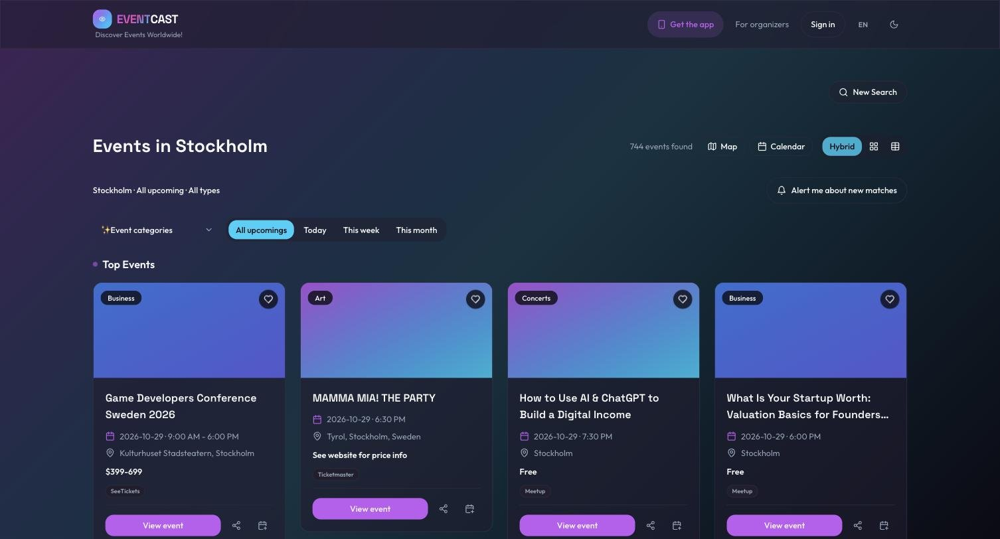
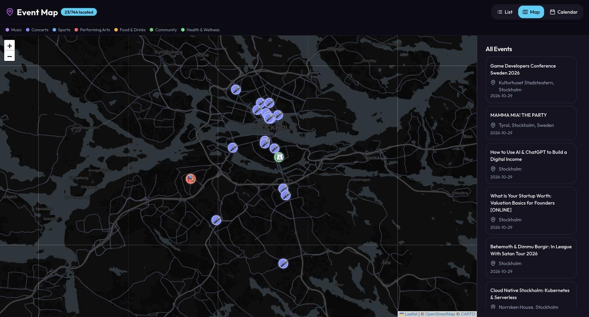
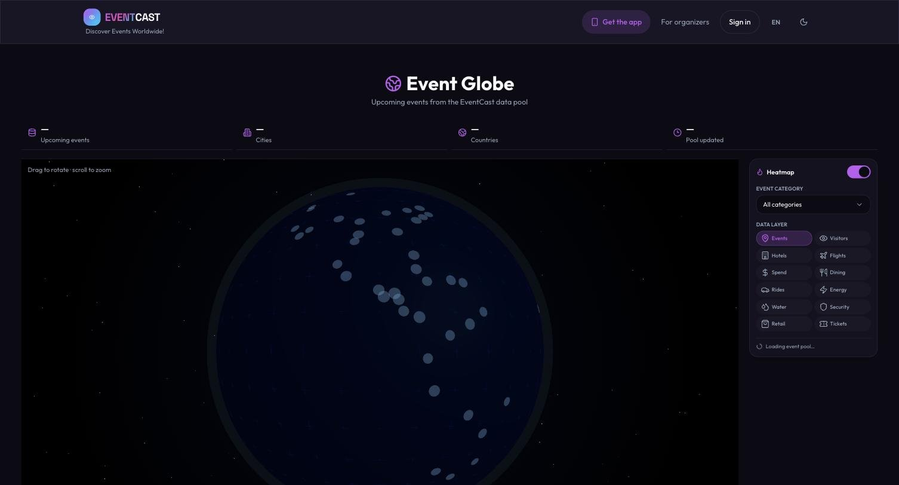
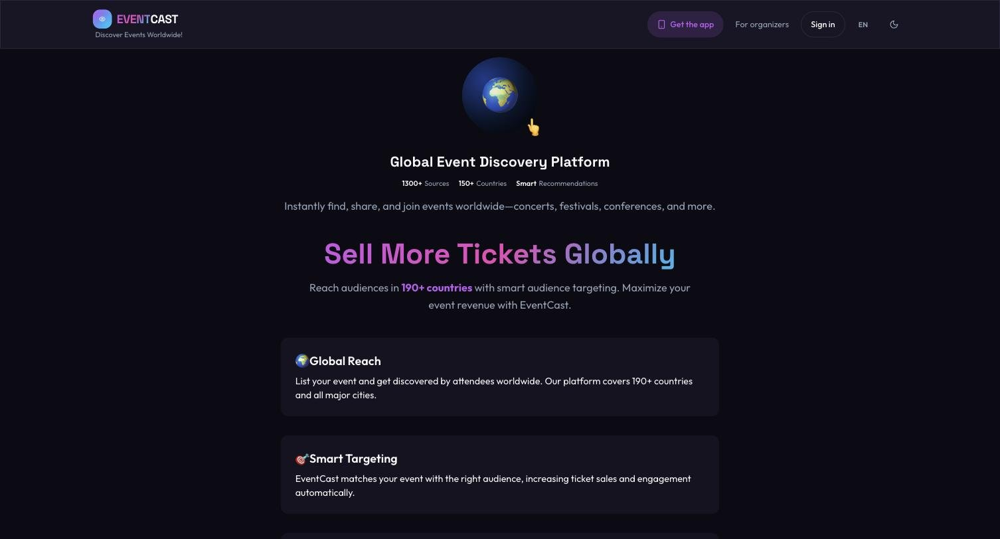
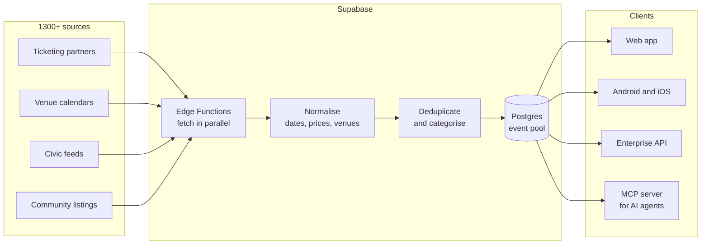
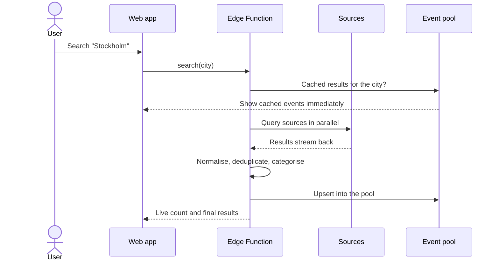
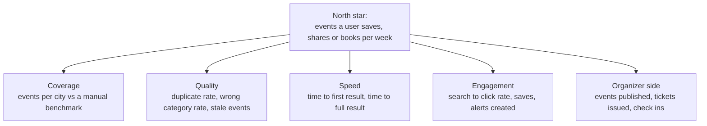

# EventCast: product case study

> **Every event in a city, from every source, in one search.**
> 🌐 [eventcast.online](https://eventcast.online) · Selected as an ALPHA startup at **Web Summit Lisbon 2026**



This repo is a product case study of EventCast, a global event discovery platform I work on. It covers the problem, the users, how the product is built, the decisions behind it and what comes next. The production code is private; the [`dedupe_demo/`](dedupe_demo) folder contains a standalone, runnable reimplementation of one of its core problems.

**Contents**
1. [The problem](#1-the-problem)
2. [Who it's for](#2-who-its-for)
3. [The product today](#3-the-product-today)
4. [How it works](#4-how-it-works)
5. [Key product decisions](#5-key-product-decisions)
6. [A hard problem up close: deduplication](#6-a-hard-problem-up-close-deduplication)
7. [How we measure it](#7-how-we-measure-it)
8. [What's next](#8-whats-next)
9. [What I learned](#9-what-i-learned)

## 1. The problem

Finding something to do in a city means checking five places: Ticketmaster for concerts, Meetup for tech evenings, a venue's own calendar, Eventbrite for workshops, a local listings site. Each one covers a slice of the city. None of them answers the real question: **what's on in Stockholm this weekend, across everything?**

Organizers have the mirror image of that problem. They publish on several platforms, pay fees on each one, and still don't know whether their date or city was a good choice until tickets do or don't sell.

## 2. Who it's for

| | Attendees | Organizers | Developers and AI agents |
|---|---|---|---|
| **Job to be done** | "Show me everything happening where I am, so I can pick" | "Get my event in front of the right people and sell more tickets" | "Give my app or assistant reliable, clean event data" |
| **Today's workaround** | Several apps and websites, plus word of mouth | Listing on several platforms, paying fees on each | Scraping, or paying for several narrow APIs |
| **What EventCast gives them** | One search across 1300+ sources in 150+ countries | Free listing, free ticketing with QR check in, audience alerts, revenue projection | An Enterprise API and an MCP server, with pay per call pricing for agents |

## 3. The product today

**Search once, see everything.** Type a city and EventCast queries ticketing partners, venue calendars, civic feeds and community sources at the same time, then cleans, deduplicates and categorises the results.



**Several ways to browse the same results**: a hybrid card view, a sortable table, a calendar and a map.



**Event globe**: the whole global event pool on an interactive 3D globe, with data layers such as visitors, hotels, flights and spending, which point towards the organizer analytics side of the product.



**For organizers**: publish an event, issue free tickets with unique QR and barcodes, set capacity limits and check people in at the door, alert interested audiences, and see a revenue projection.



**For developers and AI agents**: an Enterprise API and an **MCP server**, so ChatGPT, Claude, Cursor and other agents can query live events ("list festivals in Stockholm next weekend"). Machine to machine calls are priced per call over the **x402** payment protocol, and failed calls are never charged.

Other features: saved favourites, alerts for new matches, an offline fallback that serves cached results when sources are slow, and web, Android and iOS apps.

## 4. How it works



| Layer | Choice | Why |
|---|---|---|
| Web client | React and TypeScript, first built with Lovable | Ship a working product fast, then harden it |
| Mobile | Android and iOS builds alongside the web app | Reach people where they search for plans |
| Backend | Supabase: Postgres, Auth, Edge Functions | Managed infrastructure, so the team spends time on the product |
| Data access | Drizzle ORM and a shared API layer | Typed queries shared between web, mobile and the public API |
| Maps | Leaflet with CARTO tiles | Lightweight, no per load fees |
| Agent access | MCP over streamable HTTP, x402 for payments | Lets AI agents become a distribution and revenue channel |

More detail in [docs/ARCHITECTURE.md](docs/ARCHITECTURE.md).



## 5. Key product decisions

The full decision log, with the options considered and the tradeoffs, is in [docs/PRODUCT_DECISIONS.md](docs/PRODUCT_DECISIONS.md). In short:

1. **Aggregate instead of asking organizers to list.** A marketplace with no events has no users. Aggregating first means day one already has thousands of events in every city.
2. **Show a live counter while searching.** A deep search can take up to a minute. Showing "N events found so far" and serving cached results first turns waiting into progress.
3. **Free ticketing for organizers.** It removes the main reason not to try EventCast, and every ticket issued is a first party event in the pool.
4. **Treat AI agents as a customer segment.** People increasingly ask assistants "what's on this weekend?". An MCP server with per call pricing makes EventCast the data source behind those answers.
5. **One pool, many views.** List, table, calendar, map and globe all read the same cleaned pool, so new views are cheap to build.

## 6. A hard problem up close: deduplication

The same concert appears on a ticketing site, the venue's calendar and a community page, each with a different title, start time and venue name:

| Source | Title | Venue | Time |
|---|---|---|---|
| Ticketing | Nordic Lights Tour 2026 – Live in Stockholm | Avicii Arena | 20:00 |
| Venue calendar | Nordic Lights | Globen | 20:00 |
| Community | NORDIC LIGHTS live @ Ericsson Globe!! | Ericsson Globe | 19:30 |

If all three show up, results feel broken. But merge too eagerly and you combine two different meetups at the same venue, or an early and a late show.

[`dedupe_demo/`](dedupe_demo) is a runnable, dependency free reimplementation of the approach:

1. **Normalise**: strip noise words ("tour", "live", "2026", city names), remove the venue name from the title, map venue aliases (Avicii Arena = Ericsson Globe = Globen).
2. **Block**: only compare listings in the same city on the same day, which keeps the number of comparisons small.
3. **Gate on time**: more than 1.5 hours apart means a different session, however similar the title.
4. **Weight rare words**: an IDF weighted, fuzzy title match, so "Python Stockholm December meetup" and "Rust Stockholm December meetup" stay separate (shared words are common, the differing word is rare) while "Lucia Concert" and "Luciakonsert i Storkyrkan" merge.
5. **Cluster and merge**: union find over matching pairs, then build one canonical event, preferring trusted sources for each field.

```bash
cd dedupe_demo
python3 dedupe.py        # 22 raw listings -> 13 unique events
python3 -m pytest tests  # 6 tests covering the edge cases above
```

On the included sample of 22 listings it reaches 100% pairwise precision and recall. The sample is small and the rules were tuned on it, so in production this needs a much larger labelled set and continuous monitoring of merge errors.

## 7. How we measure it



Details and target ranges are in [docs/METRICS.md](docs/METRICS.md).

## 8. What's next

| Now | Next | Later |
|---|---|---|
| Category accuracy across sources | Organizer revenue forecasts per date and location | Paid promotion for organizers |
| Freshness: expire past events faster | Personalised recommendations | Partnerships with tourism boards |
| Speed of the deep search | Saved searches with weekly digests | Self serve API plans |

See [docs/ROADMAP.md](docs/ROADMAP.md) for the reasoning. A first public prototype of the forecasting idea is in [event_demand_forecast](https://github.com/sarimyawaredu-crypto/event_demand_forecast).

## 9. What I learned

* **Data quality is the product.** Users don't see the 1300 sources. They see one wrong category or one past event and lose trust. Cleaning beats coverage.
* **Perceived speed matters as much as real speed.** Serving cached results first and counting up live is how a deep search that can take a minute stays usable.
* **Two sided products need one side solved first.** Aggregation gave attendees a reason to come before organizers had one.
* **New channels show up fast.** AI assistants are becoming a place where people ask what to do, and an MCP server reaches them without building another app.

*Screenshots taken from eventcast.online in November 2026. This case study describes the product; it contains no EventCast source code, credentials or private data.*
