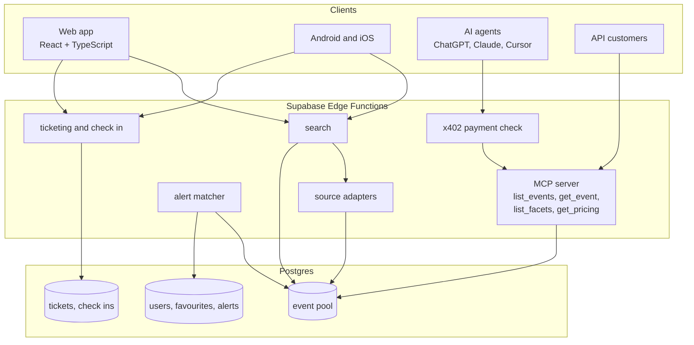

# Architecture

A high level view of how EventCast is put together. It describes the design, not the private implementation.

## Components

## The ingestion pipeline

Each source gets an **adapter** that turns its format into one shared event shape:

| Field | Notes |
|---|---|
| `title` | Cleaned of marketing noise for matching; the original is kept for display |
| `start`, `end` | Converted to the venue's local time zone |
| `venue`, `city`, `country`, `lat`, `lng` | Venue aliases resolved; geocoded if coordinates are missing |
| `category` | Mapped from each source's own taxonomy onto one EventCast taxonomy |
| `price` | Parsed into min, max and currency where possible, otherwise kept as text |
| `source`, `source_url` | Every merged event keeps links to all of its sources |

After normalisation, listings go through **deduplication** (see [`../dedupe_demo`](../dedupe_demo)) and are upserted into the event pool.

## Design principles

1. **Cache first, refresh in the background.** A search returns what the pool already knows immediately, then improves as live sources respond.
2. **Fail soft.** If a source is slow or down, the search continues without it. An offline fallback serves cached events when everything is slow.
3. **One pool, many surfaces.** Web, mobile, API and MCP all read the same cleaned data, so a quality fix improves every surface at once.
4. **Charge only for value delivered.** On the MCP pay per call endpoint, payment is captured only after a tool returns a result.

## Agent access: MCP and x402

The MCP server exposes four read only tools:

| Tool | Purpose | Cost |
|---|---|---|
| `list_events` | Search and filter by country, city, continent, category, source, date range or free text; paginated and sortable | Paid per call for machine to machine use |
| `get_event` | Full cleaned record for one event | Paid per call |
| `list_facets` | Valid filter values with counts | Paid per call |
| `get_pricing` | Current price, asset, network and payment terms | Free |

`initialize`, `tools/list` and `ping` are always free. A paid call without a payment header gets **HTTP 402** with the exact payment requirements, which is how an agent discovers the price without reading documentation.
